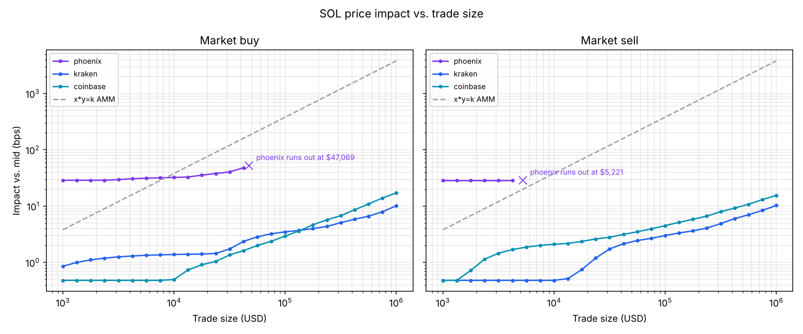

# Solana Price Impact Analyzer

How much does a large market order move the price on an on-chain order book (Phoenix, Solana)
compared with a centralized exchange? This project rebuilds a price-time priority matching engine,
loads a live Phoenix SOL/USDC snapshot into it, and simulates $1K to $1M market orders against it,
Kraken and Coinbase, plus a constant-product AMM for reference.

## Findings

Snapshot of SOL/USD(C) taken 2026-10-18 04:31 UTC (Solana slot 458,302,883). Impact is in basis
points versus each venue's own mid, including half the spread; orders may trade at most 10% from
mid.

| Venue | Spread | Within 2% of mid (bid / ask) | $1K buy | $10K buy | $100K buy | $1M buy |
| --- | ---: | ---: | ---: | ---: | ---: | ---: |
| Phoenix (on-chain) | 57.7 bps | $5.2K / $47.1K | 28.8 | 32.4 | only $47K fills | only $47K fills |
| Kraken | 1.0 bps | $5.7M / $5.8M | 0.9 | 1.4 | 3.5 | 10.2 |
| Coinbase | 1.0 bps | $7.2M / $3.8M | 0.5 | 0.5 | 3.0 | 17.2 |

Sells look similar on the exchanges (10.3 and 15.5 bps at $1M). On Phoenix only $5.2K of bids sit
within 10% of mid, so a $10K sell already cannot complete.



What the numbers say:

- **At this snapshot the Phoenix Legacy SOL/USDC book was thin.** Its spread was about 60 times
  wider than Kraken's or Coinbase's, so even a $1K order paid ~29 bps, almost all of it half the
  spread. The exchanges charged under 1 bp for the same order.
- **Depth, not spread, decides large orders.** Kraken and Coinbase each held millions of dollars
  within 2% of mid, so a $1M market buy cost only 10–17 bps. Phoenix ran out at $47K of buys.
- **The raw book contains junk quotes.** Phoenix's account held bids as low as $0.001 and asks as
  high as $9,999,999,999. Without price protection a "$1M buy" would fill against them and report
  an impact of about 56,000 bps, so the simulator caps every order at 10% from mid, as a real
  taker's limit price would.
- **An AMM holding the same near-mid liquidity behaves differently.** An x·y=k pool as deep within
  2% as Phoenix needs $2.6M per side. It has no spread, so it beats Phoenix for small trades (3.8
  bps at $1K), but its curve is steeper: about 180 bps at $47K, where Phoenix was at 53 bps.

This is one snapshot. Liquidity changes through the day, so the numbers are worth re-running
(`python -m impact_analyzer run`) before quoting them.

## How it works

```
Solana RPC ──getAccountInfo──▶ phoenix.py ─┐
Kraken REST ─────────────────▶ cex.py ─────┼──▶ BookSnapshot ──▶ convert.py ──▶ OrderBook
Coinbase REST ───────────────▶ cex.py ─────┘   (ticks + lots)                  (matching engine)
                                                                                     │
                                       impact.py: one market order per size ◀────────┘
                                                     │
                                  table · results.json · plot.py chart · playground export
```

1. **Fetch.** Phoenix stores a whole market in one Solana account. `phoenix.py` downloads its raw
   bytes over JSON-RPC and decodes them with `struct`, using the same layout as Ellipsis Labs'
   own Python client (`phoenix-trade`). Kraken and Coinbase publish their books as JSON.
2. **Normalize.** Every venue becomes a `BookSnapshot` of integer ticks and lots, best price first
   and oldest first within a price, so the rest of the pipeline is identical for every venue.
3. **Match.** `convert.py` replays the snapshot into the engine. `impact.py` then sends a market
   order of each size to a fresh copy of the book and records the fills.
4. **Measure.** Impact is `(average fill − mid) / mid × 10,000` bps for buys (sign flipped for
   sells). It includes the half-spread, so spread dominates small trades and depth dominates large
   ones.

### The matching engine

| Structure | Why |
| --- | --- |
| `SortedDict` of price → level per side | best price in O(1), a new price level in O(log L) |
| Doubly linked list of orders per level | FIFO time priority; unlink from anywhere in O(1) |
| `dict` of order id → node | cancel jumps straight to the node in O(1) |

Fills always print at the resting (maker) order's price; a partially filled maker keeps its place
at the head of the queue. Prices and sizes are integers end to end, as in Phoenix: money must be
exact (every token atom accounted for, which floats can't promise), token amounts are integers to
begin with, and an exact integer price is a reliable key for a price level. (Solana does allow
floats, emulated in software so every validator agrees, but they are slow and still inexact.)

`tests/test_engine_properties.py` uses Hypothesis to run thousands of random sequences of adds,
cancels and market orders through the engine and through a deliberately naive reference model, and
requires identical fills after every step, plus invariants: never crossed, linked lists intact,
lots conserved (`HYPOTHESIS_PROFILE=thorough pytest` for 5,000 sequences).
`python -m benchmarks.mutation_check` plants 8 realistic bugs in a copy of the engine (a partial
fill losing its queue place, an empty level left behind, an off-by-one limit, an IOC that rests...)
and checks that the tests catch every one: 8/8.

`python -m benchmarks.bench_engine --markdown` replays 1M random adds, cancels and market orders
(seed 0) and times each call:

Intel64 Family 6 Model 183 Stepping 1, GenuineIntel; Python 3.14.6 (Windows); timer resolution
100 ns, so percentiles are multiples of it.

Throughput: **757,703 events/s** (1,320 ns/event mean).

| Operation | Count | Mean (ns) | p50 (ns) | p99 (ns) |
| --- | ---: | ---: | ---: | ---: |
| add, rests at an existing level | 416,248 | 1,129 | 1,100 | 1,800 |
| add, creates a new level | 183,656 | 1,711 | 1,600 | 2,800 |
| cancel, order is resting | 151,221 | 592 | 600 | 1,000 |
| cancel, order already filled (no-op) | 149,195 | 113 | 100 | 200 |
| market order | 99,680 | 4,040 | 3,800 | 10,100 |

Cancel is the cheapest real operation because the id map jumps straight to the node and the linked
list unlinks it in O(1); a cancel that lost the race to a fill is a single dict miss. A new price
level costs about 600 ns more than joining an existing one (the O(log L) `SortedDict` insert plus a
new `PriceLevel`), and market orders have the long tail because a large one sweeps several levels.
All numbers are pure Python and include method-call overhead, so they show relative costs, not what
a compiled Rust engine would do.

## Run it

Requires Python 3.11+.

```sh
python -m venv .venv
source .venv/bin/activate          # Windows PowerShell: .venv\Scripts\Activate.ps1
pip install -e ".[dev]"
pytest                             # offline test suite
python -m impact_analyzer demo     # whole pipeline on synthetic books, no network
python -m impact_analyzer run      # live: fetch all three venues, analyze, chart
```

Other commands: `fetch` (save snapshots to `data/`), `analyze [files...]` (re-run on saved
snapshots; defaults to the newest per venue). The public Solana RPC is rate limited; set
`SOLANA_RPC_URL` or pass `--rpc` to use another. `--max-slippage 5` changes the price protection
band (default 10%). `pytest -m network` runs the live smoke test.

### Collect over time

```sh
python -m impact_analyzer collect --every 5m --duration 24h   # into data/collect.sqlite
python -m impact_analyzer status                              # progress, failures, latency
```

Every 5 minutes the collector fetches all three books at the same moment (plus the Solana slot),
then asks Jupiter for real AMM quotes ($1K–$1M, buy and sell, per route: best, SolFi, Phoenix,
Whirlpool, Raydium CLMM, Meteora DLMM), and writes the tick to SQLite in one transaction. A venue
that fails is recorded with its error while the others carry on; 429s and 5xx are retried with
backoff (Jupiter's free tier allows 5 requests per 10 s). Ctrl+C stops after the current tick,
and `collect --resume` continues the run where it left off.

`run` also writes `data/playground.json`, which the interactive Order Book Playground can load to
draw the real books and their impact curves side by side.

## Layout

| Path | What it is |
| --- | --- |
| `src/impact_analyzer/orderbook.py` | Limit order book + price-time priority matching engine |
| `src/impact_analyzer/snapshot.py` | Venue-neutral snapshot (ticks, lots), JSON save/load |
| `src/impact_analyzer/phoenix.py` | Fetch and decode a Phoenix market account |
| `src/impact_analyzer/cex.py` | Kraken and Coinbase order books |
| `src/impact_analyzer/convert.py` | Snapshot → engine `OrderBook` |
| `src/impact_analyzer/impact.py` | Average fill price and impact in bps |
| `src/impact_analyzer/amm.py` | Constant-product (x·y=k) pool with equivalent depth |
| `src/impact_analyzer/plot.py` | Impact vs. trade size chart |
| `src/impact_analyzer/synthetic.py` | Made-up books for the offline demo and tests |
| `src/impact_analyzer/__main__.py` | Command line |
| `benchmarks/` | Random order flow + throughput benchmark |
| `tests/` | pytest suite (Phoenix decoder tested on an encoded synthetic account) |

## Caveats

- A snapshot is one instant. Real takers face makers who re-quote, and other takers.
- Kraken returns at most 500 aggregated levels, and Coinbase's level 2 book is aggregated too. A
  large order can exhaust what the API shows even when the venue has more; the table marks partial
  fills with `*`.
- Every simulated order carries price protection: it stops 10% from mid (`--max-slippage`).
- Fees are excluded from the order book numbers (Phoenix's taker fee is saved in the snapshot).
- The AMM benchmark is sized to hold the same USD within 2% of mid as the Phoenix book. It
  answers "what if this liquidity sat in an x·y=k pool instead?", not what any real pool holds.
